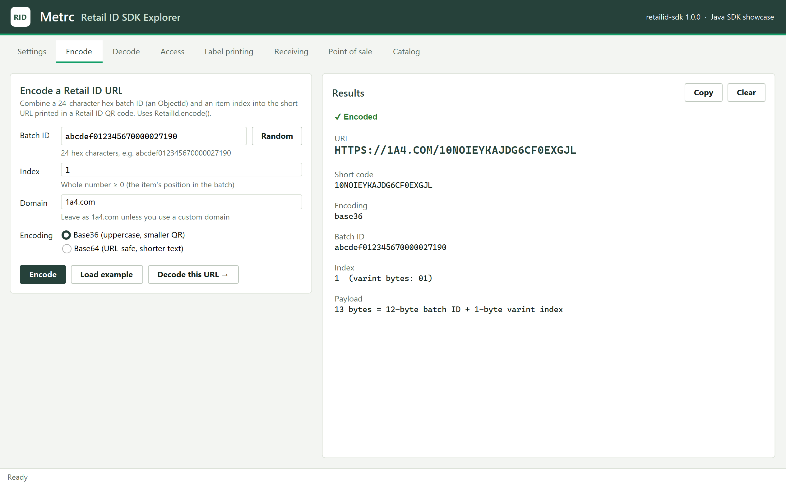
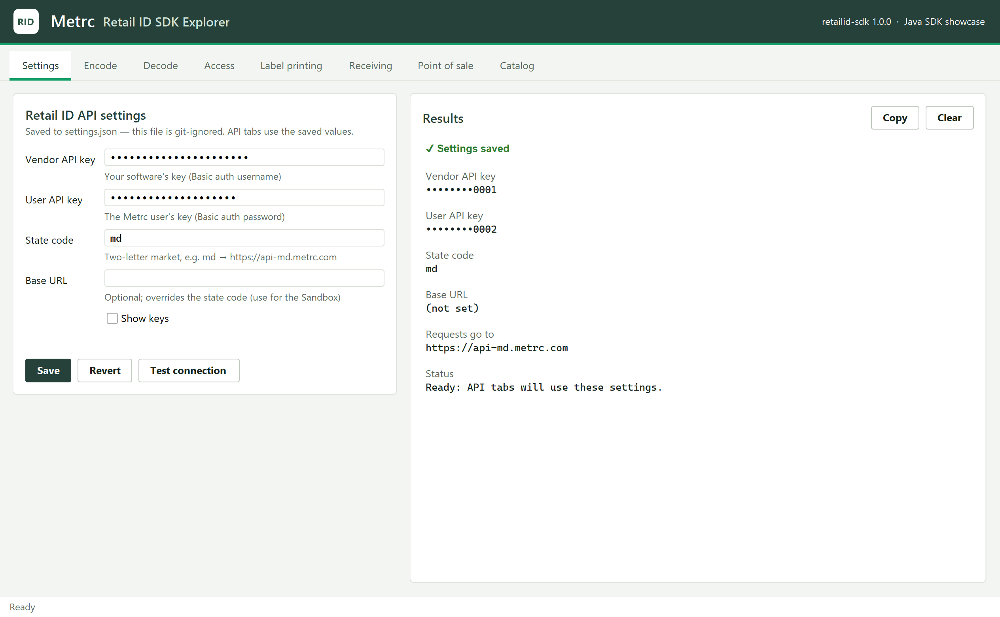
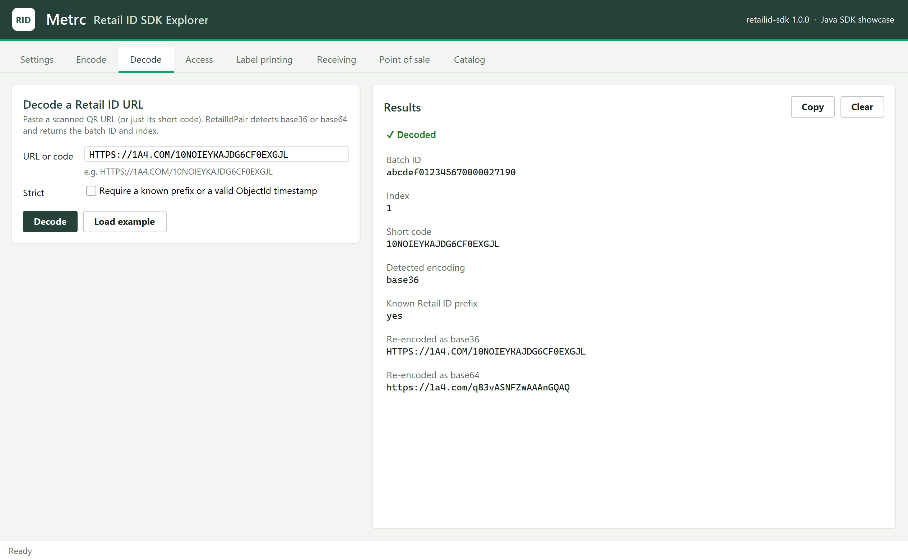
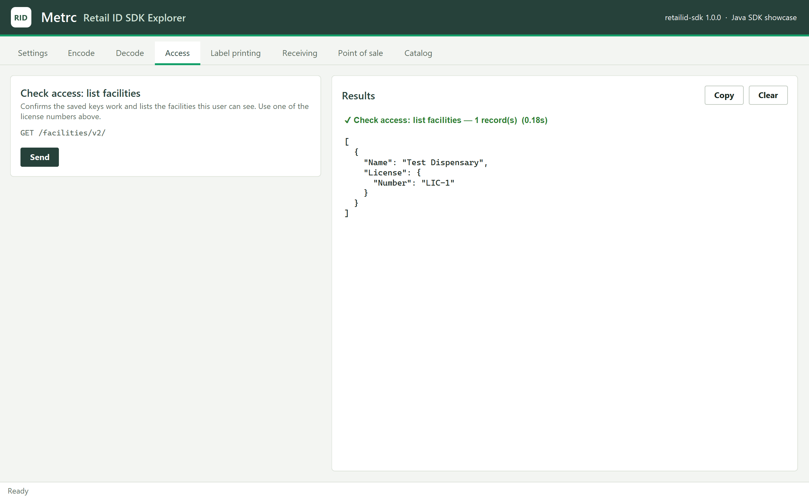
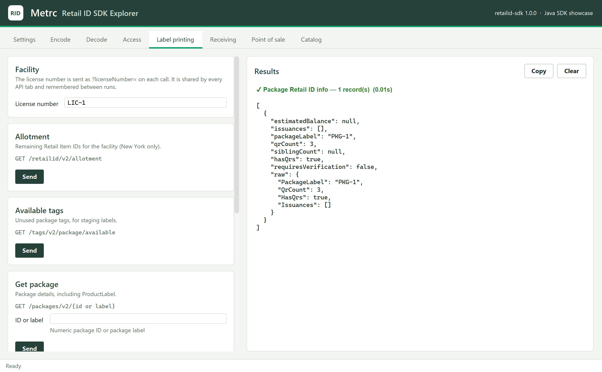
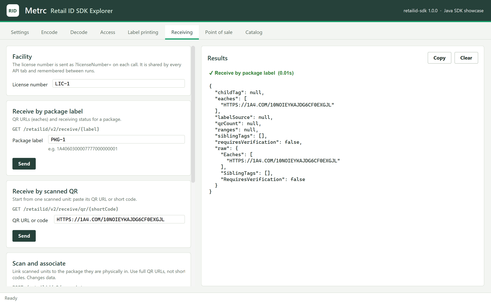
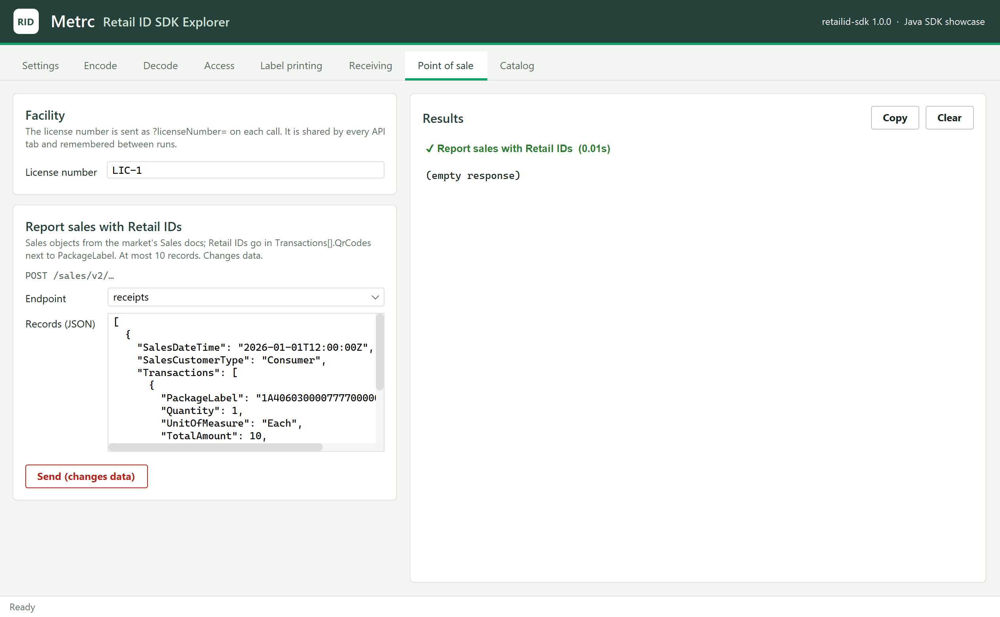
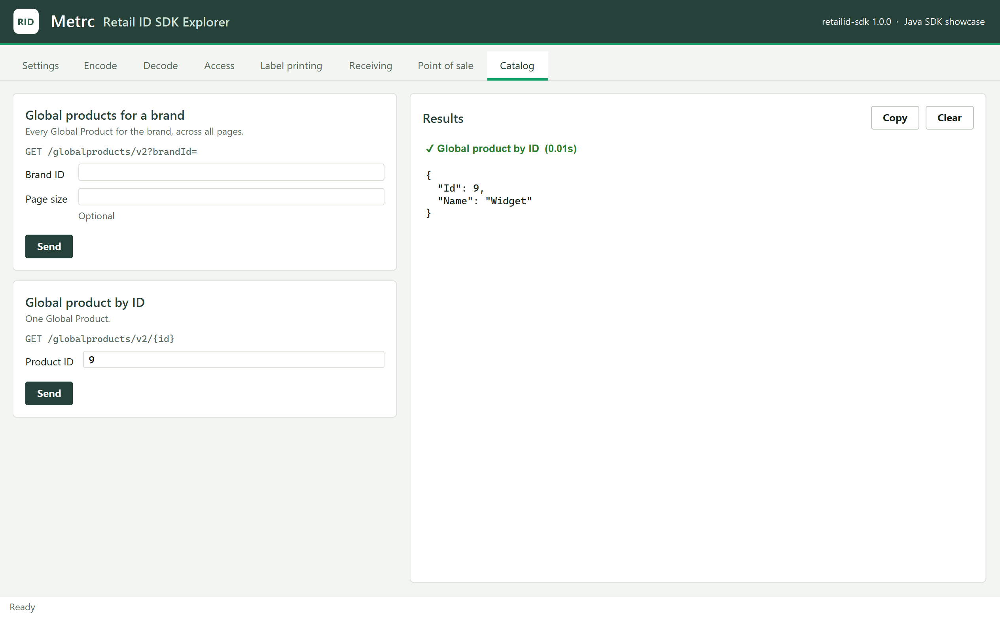

# rid-sdk-java-example

Example Java GUI app showcasing the rid-sdk features.

**Retail ID SDK Explorer** is a desktop app (Swing) for trying the Metrc Retail ID
Java SDK (`com.retailid`, from
[rid-sdk/java](https://github.com/nathanhouse-metrc/rid-sdk/tree/main/java)) without
writing code. Each SDK feature has inputs, action buttons and a results panel. It
matches the [Python example](https://github.com/nathanhouse-metrc/rid-sdk-python-example)
feature for feature.

| Tab | SDK feature |
| --- | --- |
| **Settings** | Enter and save `vendor_api_key`, `user_api_key`, `state_code` and `base_url`; *Test connection* calls `getFacilities()` |
| **Encode** | `RetailId.encode(batchId, index, EncodeOptions)`: batch ID + index → Retail ID URL (base36 or base64, custom domain) |
| **Decode** | `new RetailIdPair(url, strict)` and `RetailIdClient.shortCodeFromUrl()`: URL or short code → batch ID + index, re-encoded both ways |
| **Access** | `getFacilities()` |
| **Label printing** | `getAllotment()`, `getAvailableTags()`, `getPackage()`, `getPackagesInfo()`, `generate()` |
| **Receiving** | `receive()`, `receiveByQr()`, `associatePackage()`, `merge()` |
| **Point of sale** | `postSales()` to any of the sales endpoints (`receipts`, `deliveries`, …) |
| **Catalog** | `getGlobalProducts()`, `getGlobalProduct()` |

Encode and Decode work offline. The API tabs use a `RetailIdClient` built from
the saved settings, and share one facility license number field. API calls run
in the background so the window stays responsive. Calls that change data in
Metrc (generate, associate, merge, sales) have a red *Send (changes data)*
button and ask for confirmation first.

## Screenshots



<details>
<summary>More screenshots</summary>

**Settings**: keys are masked once saved.



**Decode**: a scanned URL broken back into batch ID and index.



**Access**: checking the saved keys by listing facilities.



**Label printing**: Retail ID info for a package.



**Receiving**: QR URLs and status for a package.



**Point of sale**: reporting a sale with Retail IDs in `QrCodes`.



**Catalog**: one Global Product.



</details>

The API results in these screenshots come from the local fake API used by the
tests, not from Metrc. Swing paints the window straight into the images, so the
window never appears on screen. To regenerate them after changing the UI:

```bash
./mvnw -q test-compile exec:exec@screenshots
```

## Requirements

- JDK 17 or newer (for example [Eclipse Temurin](https://adoptium.net/)). Maven
  is not needed: the included Maven wrapper (`mvnw` / `mvnw.cmd`) downloads it
  on first use.
- A local checkout of [rid-sdk](https://github.com/nathanhouse-metrc/rid-sdk) **next to
  this repository**:

  ```
  git/
  ├── rid-sdk/                ← SDK checkout
  │   └── java/               ← the com.retailid SDK
  └── rid-sdk-java-example/   ← this repo
  ```

  The API tabs need the SDK's Retail ID API client (`com.retailid.api`). If your
  rid-sdk checkout does not have `java/src/main/java/com/retailid/api/` yet,
  check out a branch that does (for example `java-api-1`). The build stops with
  a message saying so if the SDK is missing.

## How the SDK is included

The build compiles the SDK's sources from `../rid-sdk/java/src/main/java` along
with the app (see `rid.sdk.dir` in `pom.xml`), so SDK changes are picked up on
the next build without installing anything. If your rid-sdk checkout lives
elsewhere, pass its `java` folder:

```bash
./mvnw package -Drid.sdk.dir=/path/to/rid-sdk/java
```

The only other runtime dependency is [FlatLaf](https://www.formdev.com/flatlaf/),
the Swing look and feel the Metrc colours are applied on top of.

## Look and feel

Colours and fonts follow the Metrc design used in Metrc's shared prototypes
(forest-green brand bar, warm off-white surfaces, Inter and IBM Plex Mono), the
same tokens as the Python example; all of them are in
`src/main/java/com/retailid/example/Theme.java`. Inter and IBM Plex Mono are
used when installed (free from Google Fonts); otherwise the app falls back to
Segoe UI / Helvetica and Cascadia Mono / Consolas / Menlo.

## Build and run

Windows (PowerShell or cmd):

```powershell
cd rid-sdk-java-example
.\mvnw.cmd package
java -jar target\rid-sdk-explorer.jar
```

macOS / Linux:

```bash
cd rid-sdk-java-example
./mvnw package
java -jar target/rid-sdk-explorer.jar
```

`package` runs the tests and builds `target/rid-sdk-explorer.jar`, a single
runnable jar with the SDK and FlatLaf inside. While working on the code you can
also run it straight from the sources with `./mvnw compile exec:java`.

Run it from the repository root so it finds `settings.json` there. On first
launch the app opens on **Settings**. Fill in your keys and either a
`state_code` (e.g. `md` → `https://api-md.metrc.com`) or a `base_url` (which
overrides the state code; use it for the Sandbox), then **Save** and **Test
connection**.

## Where settings are stored

Settings are saved to `settings.json` in the working directory (the repository
root when you follow the steps above), using the same keys as the SDK's
`config.json`, so the file also works with
`RetailIdClient.fromConfig(Paths.get("settings.json"))`. The app also remembers
the last facility license number there, and keeps any other keys you add
(`timeout`, `max_retries`, `backoff_base`).

`settings.json` holds your API keys and is listed in `.gitignore`; never commit
it. To keep it somewhere else, set `RID_EXAMPLE_SETTINGS` (or the
`rid.example.settings` system property) to a file path before starting the app.

## Tests

The tests drive every tab against the real SDK, with a local fake of the Retail
ID API, so they need no keys and change nothing in Metrc:

```bash
./mvnw test
```

## Project layout

```
src/main/java/com/retailid/example/
├── Main.java          entry point: opens the window
├── App.java           header, tabs, status bar, background task runner
├── SettingsTab.java   Settings tab
├── EncodeTab.java     Encode tab
├── DecodeTab.java     Decode tab
├── ApiActions.java    one Action per RetailIdClient method, grouped into tabs
├── ApiTab.java        builds an API tab from its actions and runs them
├── Settings.java      load/save settings.json
├── Errors.java        SDK exceptions → readable messages
├── JsonText.java      SDK results → indented JSON
├── Theme.java         colours, fonts and look-and-feel settings
├── Card.java          input card
├── ResultView.java    results panel
└── Ui.java            layout helpers
src/test/java/com/retailid/example/
├── AppTest.java           end-to-end tests
├── FakeApi.java           fake Retail ID API server
└── TakeScreenshots.java   regenerates docs/screenshots/
```
